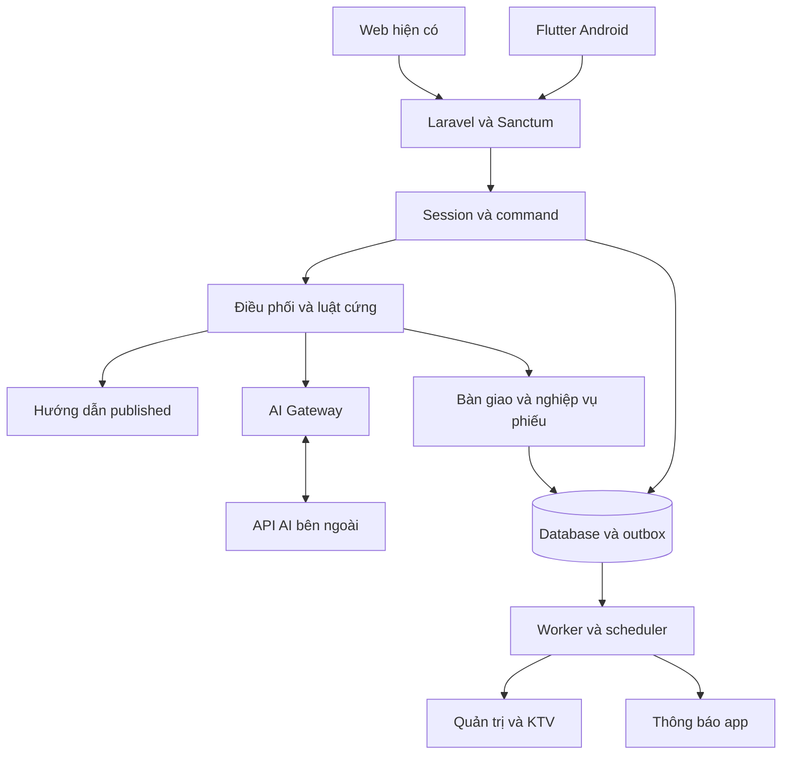

# 02 — Kiến trúc, trạng thái và luồng xử lý

## 1. Nền tảng giữ nguyên

Laravel ở gốc repository; website ở public/ và resources/views/; API ở routes/api.php; session/token qua Sanctum; database và nghiệp vụ phiếu hiện có. App Flutter dự kiến ở mobile/. Không chuyển dự án sang monorepo backend/web mới, không thêm dịch vụ Python để chỉ gọi API.

## 2. Bản đồ module — TARGET toàn sản phẩm

Sơ đồ dưới đây là kiến trúc đích; Flutter, guide-catalog, outbox, worker/delivery, push và cost reservation chưa có trong lát cắt web hiện tại. Không triển khai frontend gọi endpoint TARGET chỉ vì xuất hiện ở sơ đồ.

| ID | Trách nhiệm | Phụ thuộc |
| --- | --- | --- |
| support-session | Lưu phiên/tin/lệnh và thứ tự | Identity, phòng/thiết bị hiện có |
| guide-catalog | Hướng dẫn và phiên bản được duyệt | Dữ liệu thiết bị |
| ai-gateway | Gọi nhà cung cấp, schema, thời hạn, usage | Cấu hình, quota dùng chung |
| support-orchestration | Xác định hành động hợp lệ của lượt | session, guide-catalog, ai-gateway |
| ticket-handoff | Lưu lượt báo, tạo/liên kết phiếu | session, nghiệp vụ phiếu |
| support-delivery | Outbox, gửi, nhắc, người trực | Sự kiện bàn giao đã commit |
| support-clients | Web/Flutter và trạng thái UI | API nghiệp vụ |
| support-operations | Theo dõi, cấu hình và phục hồi | Các module vận hành |

Không tạo phụ thuộc vòng: orchestration gọi handoff; handoff không gọi orchestration. Worker delivery không quyết định chẩn đoán. Đầu ra model không phải quyền thực thi.



## 3. Cấu trúc nguồn

Đã có M1a: SupportSessionController, StoreSupportSessionRequest, SupportSessionPolicy, SessionCreationService, SupportSession/SupportMessage, SupportApiResponse và migration 2026_11_19_000001.

CURRENT_CODE CR-01–13 đã có: SupportConversationController; SupportConversationService (điều phối đồng bộ), ConversationContext (intake/ý định), SupportDiagnosticFlow (projection quan sát), ConversationBrief/ConversationFallback/ConversationReportService; HelpdeskAiService; TicketCreationService; SupportCommand/SupportReport; portal partial/JS/CSS và tests liên quan. File sở hữu và thứ tự tiếp tục tại [plan](../../tasks/plan.md). Không tạo service thay thế hoặc kho receipt cạnh tranh chỉ vì tên trong sơ đồ khác.

Dự kiến thêm khi có task tương ứng (TicketCreationService đã có, không tạo lại):

```text
app/Services/Support/
    SupportAgentService.php
    AiClient.php
    GuideEligibilityService.php
    SessionCommandService.php
    EscalationService.php
app/Jobs/ProcessSupportTurn.php
app/Jobs/DeliverSupportNotification.php
tests/Feature/Support/
tests/Unit/Support/
mobile/
```

Danh sách này không bắt buộc tạo mọi file trước. Không tạo service rỗng hoặc endpoint giả chỉ để trông đủ kiến trúc.

## 4. Trạng thái phiên — enum và vòng đời TARGET

CURRENT_CODE: enum có cả 6 giá trị nhưng CR-01 chủ yếu ghi collecting/handoff_pending/handed_off/resolved. awaited result/attempt/cancellation endpoint chưa triển khai. Command thực có processing/handoff_pending/completed và operation chat/report/resolve/clarify, chưa phải enum pending/succeeded/failed/discarded của TARGET. CR-13 diagnosis.stage là projection quan sát riêng (contract 03), không đổi session status; câu hỏi quan sát không phải attempt của guide đã duyệt.

| Status | Ý nghĩa | Lệnh thay đổi hợp lệ |
| --- | --- | --- |
| collecting | Thu thập thông tin | Phát bước, xác nhận đã được, chuyển cấp, hủy |
| awaiting_result | Có một bước đang chờ kết quả | Ghi kết quả, chuyển cấp, hủy |
| handoff_pending | Đã nhận yêu cầu bàn giao | Commit phiếu/liên kết; retry lỗi |
| handed_off | Đã có lượt báo/phiếu | Theo dõi và bổ sung; không tiếp tục hướng dẫn |
| resolved | Người dùng xác nhận tự giải quyết | Mở lại phiên hoặc báo tái diễn |
| cancelled | Chủ động hủy trước bàn giao | Xem lịch sử, tạo phiên mới |

Trạng thái lượt AI TARGET riêng: pending, processing, succeeded, failed, discarded. Không đổi session thành processing. Queue delay không đồng nghĩa người dùng đã hủy. handoff_pending TARGET có thể giữ next_attempt_at; CURRENT_CODE không có trường đó hoặc worker tự retry, chỉ có receipt + retry client. Không giả handed_off.

Sơ đồ chuyển trạng thái chuẩn nằm tại [DG-ST-01](so-do/05_STATE_MACHINE.md). Bảng trên sở hữu enum/ý nghĩa; file sơ đồ sở hữu hình, không duy trì hai bản state diagram song song.

### Bất biến

- Một bước chưa có kết quả không được bị ghi đè bởi bước khác.
- Không có phiên handed_off mà không có support_report/ticket liên kết đã commit.
- Không có thao tác AI chuyển handed_off/cancelled trở lại hướng dẫn.
- resolved phải có bằng chứng xác nhận người dùng, không chỉ đề xuất model.
- Mở lại phiên tăng version, giữ lịch sử và counters; không tự reset quota để lách hạn mức.
- CURRENT_CODE CR-01/04/12/13 cho đổi room_id/category_id trong cùng chat; đổi ngữ cảnh đã biết làm brief cũ hết hiệu lực và reset phạm vi quan sát. Chưa phân biệt ổn định hai thiết bị cùng loại/cùng phòng. Không đổi hành vi này thành bắt tạo phiên mới mà không có CR.

## 5. Trạng thái phiếu

Giữ new, reopened, assigned, in_progress, resolved, closed. resolved của ticket là KTV báo hoàn thành chờ quản lý; closed là quản lý xác nhận. CR-11 chỉ xóa mềm phiên handed_off/report/ticket closed. acknowledged_by/at của hồ sơ bàn giao là TARGET M5, chưa có bảng handoff; không tự thêm ticket.status=acknowledged.

Phân công trực tiếp có thể đồng thời ghi nhận tiếp nhận. Đọc notification không làm việc đó. Giảng viên/KTV/model không được vượt quy trình quản trị duyệt đóng hoặc mở lại phiếu.

## 6. Xử lý một lượt

CURRENT_CODE: request HTTP lưu tin/command trong TX-A → ưu tiên report/resolve/an toàn/intake → gọi provider đồng bộ ngoài transaction nếu cần → ghi kết quả trong TX hoàn tất nếu version còn khớp. Không có job/queue AI, reservation token/tiền hoặc usage ledger. CR-13 chọn câu hỏi quan sát ở backend; cùng lượt model chuẩn bị brief, câu trả lời model chỉ dùng khi nhánh chưa phân loại. Tiền đề/quota/replay theo 03. Các bước worker/deadline/usage dưới đây là TARGET M3/M4, không phải hạ tầng đang chạy.

1. Kiểm tra chủ phiên, tài khoản và lệnh hợp lệ.
2. Kiểm tra idempotency và expected_version trong giao dịch ngắn.
3. Lưu tin/lệnh, snapshot version và hạn mức đã đặt trước.
4. Commit rồi gọi model ở worker; không giữ DB lock trong lời gọi mạng.
5. Nhận kết quả, kiểm tra schema và điều kiện hành động.
6. Chỉ commit kết quả khi version/snapshot vẫn hợp lệ và deadline chưa hết.
7. Ghi usage kể cả kết quả bị discarded nếu upstream đã tính phí.
8. Kết quả cũ không được hiện như bước đang hoạt động.

Lệnh chuyển trực tiếp có thể tăng version ngay để vô hiệu hóa lượt AI đang chạy. Hai client cùng ghi nhận version cũ nhận 409 và tải lại; không retry mù quáng.

## 7. Luồng bàn giao bền vững

Thiết kế TARGET dùng hai transaction local theo [BR và bảng quyết định](11_QUY_TAC_NGHIEP_VU.md): TX-A nhận intent, khóa phiên, ghi support_command pending và handoff_pending rồi commit; TX-B khóa lại command/phiên, tạo support_report, tạo/liên kết phiếu, ghi log, cập nhật handed_off, command succeeded và insert outbox trong cùng transaction. TX-B rollback thì không có thông báo thành công; receipt TX-A vẫn còn để retry/recovery. Nếu TX-A chưa commit, không xác nhận đã lưu yêu cầu.

201 chỉ sau TX-B thành công. Nếu TX-B lỗi, trả 503 kèm command_id/status_url khi TX-A đã commit; endpoint đọc command phải có từ M2. Không dùng bảng idempotency M1a chỉ lưu kết quả hoàn tất để giả làm receipt pending. Không gọi mạng trong cả hai transaction. Trình tự và các nhánh lỗi ở [sequence](so-do/03_SEQUENCE.md).

Tách snapshot gốc/bước đã thử khỏi phần tóm tắt AI. Không cần gọi model mới tạo được phiếu. Dữ liệu bắt buộc: người báo xác thực, phòng xác nhận và mô tả; danh mục Chưa xác định do backend quản lý.

Worker đọc outbox sau commit; thông báo DB có unique event-recipient-channel. Push có thể lặp khi kết quả cũ không rõ; client loại trùng theo event_id. Phiếu có thật nhưng push chưa gửi phải được hiển thị đúng.

## 8. Gộp sự cố và quyền người báo sau — TARGET

CURRENT_CODE CR-03 dùng TicketCreationService cho form/chat để chặn phiếu cùng phòng/danh mục còn new/reopened/assigned/in_progress. Chat trả 200 report=null, không liên kết hoặc tiết lộ phiếu cũ và không tạo report người báo sau. So khớp thiết bị/symptom_code, nhiều report cùng ticket và Progress DTO dưới đây chưa có. Không xóa guard hiện hành trước khi có CR/test tương thích.

Mỗi phiên có một support_report; nhiều report có thể cùng ticket. Mỗi report giữ chủ sở hữu, mô tả và context riêng.

- Chỉ tự gộp khi đúng thiết bị, cùng symptom_code đã xác nhận và đúng một phiếu đang hoạt động; bảng quyết định chi tiết ở tài liệu 11.
- Không gộp chỉ theo phòng/danh mục hoặc lời phỏng đoán của model.
- Khi auto-match chưa đủ căn cứ: không tự gộp; đưa quản trị đối chiếu.
- Tất cả luồng tạo phiếu tham gia gộp phải dùng cùng khóa thiết bị và quy tắc.
- Không có thiết bị cụ thể: bản đầu không auto-merge đồng thời.
- Progress DTO của report không trả chi tiết ticket gốc, chat người khác, ảnh riêng hay danh tính nội bộ.

## 9. Hoàn tất và quay lại

Hoàn tác nhanh đề xuất 10 phút nhưng sau đó vẫn có “Sự cố vẫn còn”. Chưa có phiếu: mở lại phiên. Đã có phiếu: gửi follow-up/yêu cầu xử lý lại; không gọi TicketController::reopen bằng quyền giảng viên hoặc AI.

## 10. Chuyển đổi từ chat hiện có — lịch sử và phần còn thiếu

M1b ở hai đoạn dưới là checkpoint lịch sử. CURRENT_CODE portal đã chuyển sang CR-01–13: hai chế độ thủ công/chat lưu phiên, gửi phiếu trong chat và projection quan sát. Legacy HelpdeskChatController/portal-chat còn phục vụ contract reply/draft cũ, không phải đường chính của portal. M3/M4 vẫn cần guide/eligibility/feature flag và nghiệm thu an toàn đầy đủ.

M1b chỉ cung cấp giao diện lưu/đọc lại phiên, có nhãn chưa bật agent. Không gọi endpoint messages/turns tương lai hoặc nối chat cũ rồi tuyên bố mọi tin đã lưu.

M3/M4 mới tích hợp hội thoại agent theo phiên qua feature flag, sau khi đường bàn giao và safety đã sẵn sàng. Khi tắt flag, form báo lỗi trực tiếp vẫn hoạt động. Không đổi hợp đồng reply/draft của chat cũ trước khi có task chuyển đổi và kiểm thử hồi quy.
