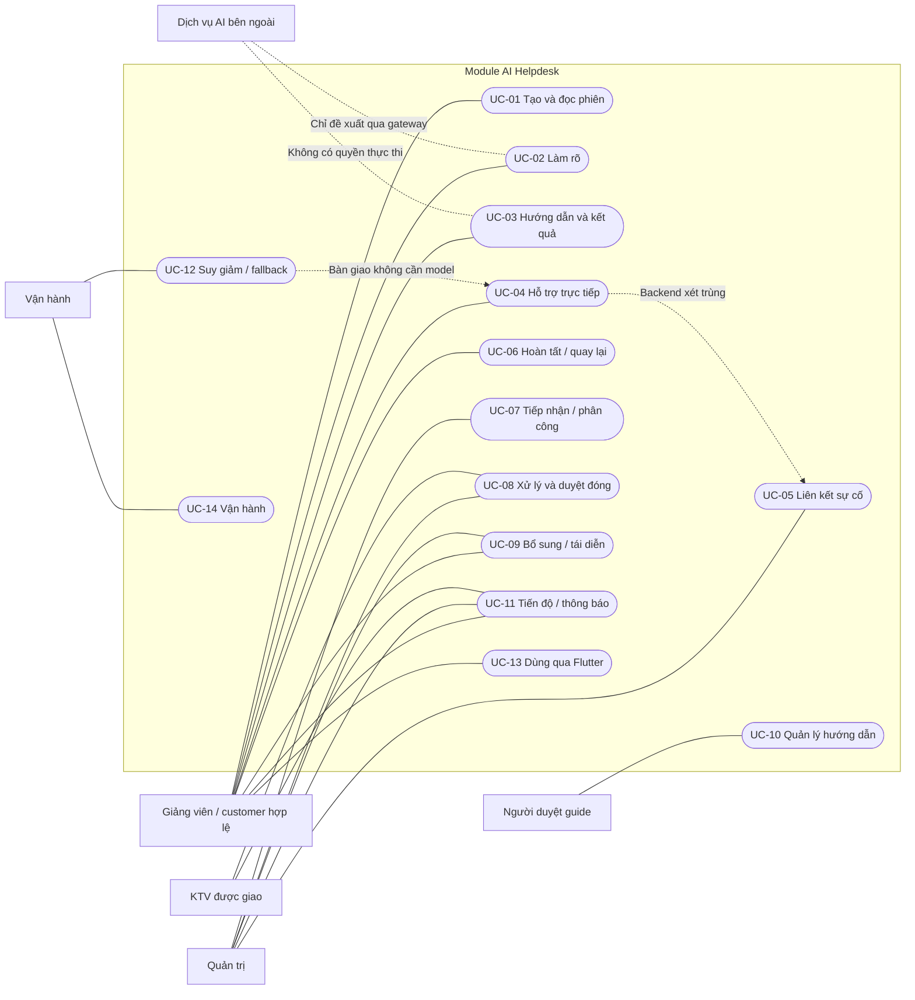

# Bản đồ use case

DG-UC-01 — TARGET. Đặc tả từng UC ở [10](../10_USE_CASE_CHI_TIET.md); quyền ở [12](../12_MA_TRAN_PHAN_QUYEN.md). Đây là functional/use-case view bằng flowchart, không dùng include/extend UML giả.

Không suy từ association rằng actor có mọi quyền con. Provider không được tiếp nhận/phân công/đóng ticket. Người soạn và người duyệt là trách nhiệm có thể phân công riêng, không tự thêm role DB khi chưa có task.
