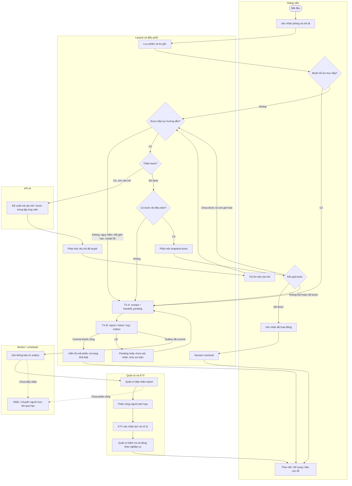

# Activity view có lane

DG-ACT-01 — TARGET, luồng chính và nhánh dừng. Lane thể hiện trách nhiệm, không thay chi tiết transaction ở sequence. Truy vết UC-01–09; BR-01–36; TC-007–018/021.

Khi thiếu facts nhưng hết giới hạn hỏi, CHECK phải chuyển receipt, không đi vào SELECT vô hạn. SELECT không có nghĩa model tự tạo nội dung thao tác: ELIG/STEP vẫn do backend kiểm tra và render. Đường STEP trong view rút gọn bao gồm model chọn ID và eligibility recheck như DG-SEQ-02.

TRACK không tự nối ngược về hướng dẫn khi đã handed_off: dùng follow-up hoặc quy tắc quay lại BR-31–36. Nếu chưa có phòng, UI thu thập vị trí/contact, chưa vào SAVE hoặc receipt có thể tạo phiếu.
