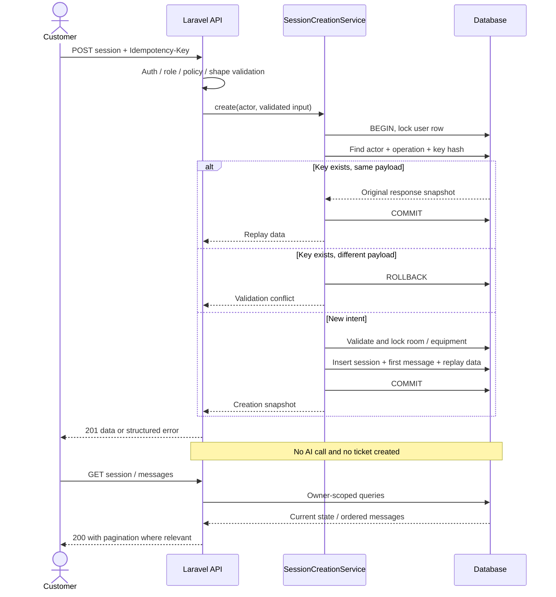
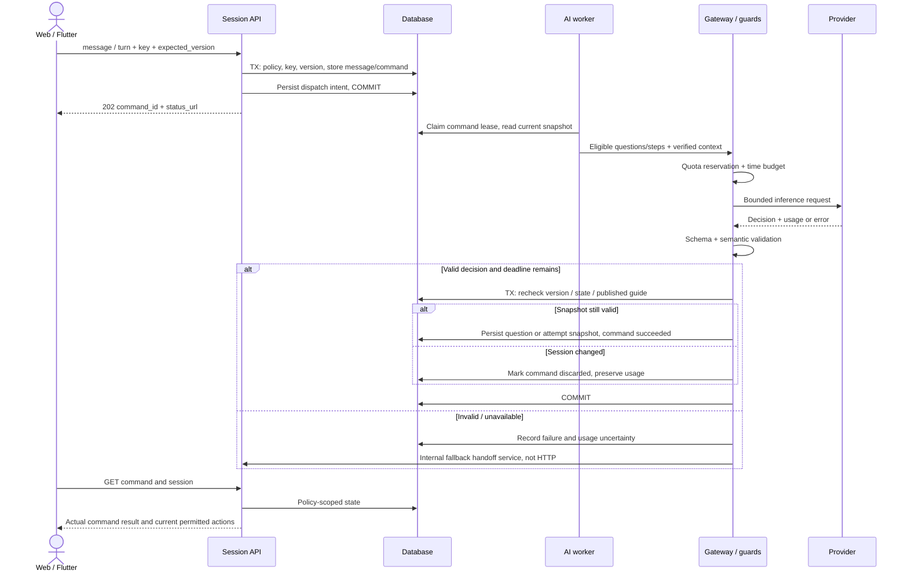
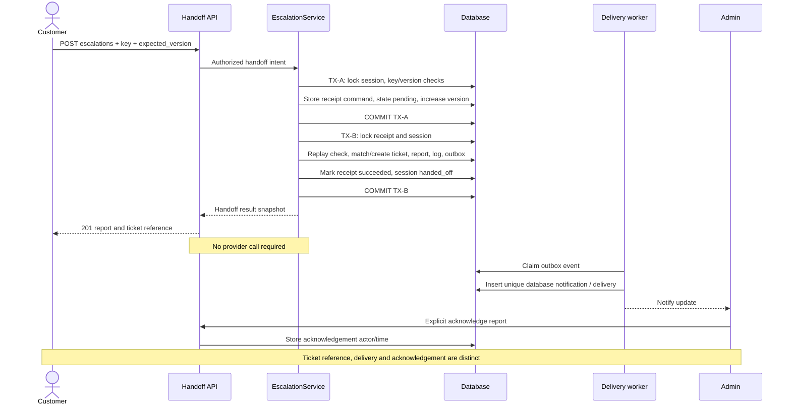
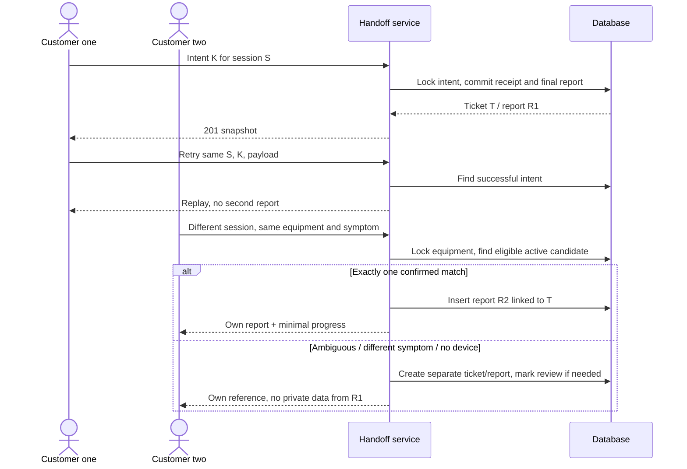
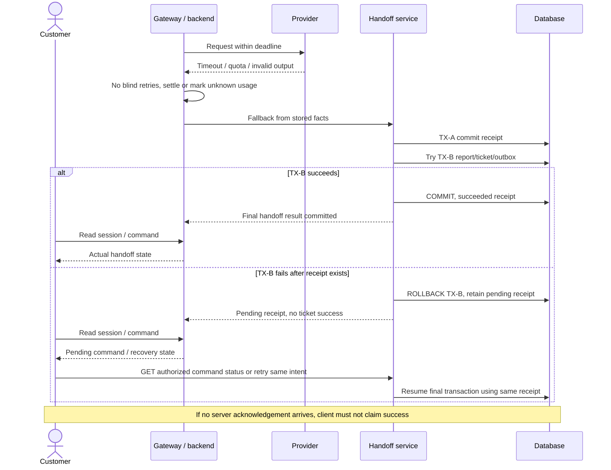
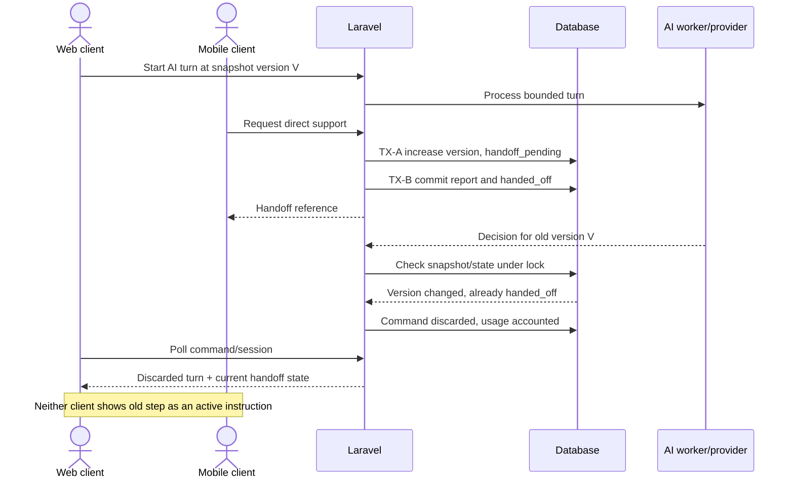
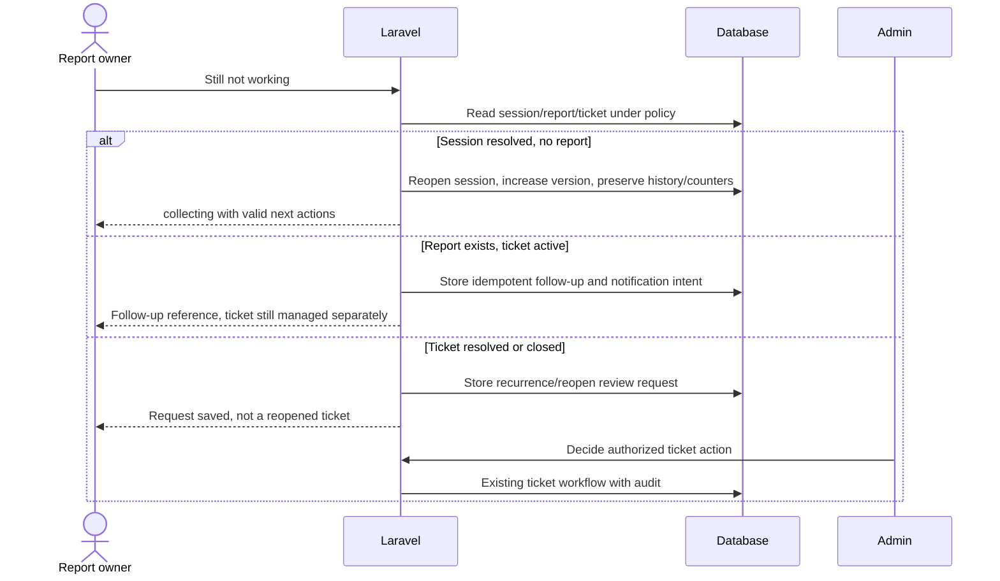

# Sequence diagrams

Mỗi sơ đồ ghi rõ CURRENT_CODE hoặc TARGET. Không tự chuyển code để khớp hình nếu hợp đồng sở hữu chưa được cập nhật. Đường gọi nội bộ là service invocation, không phải server tự HTTP vào endpoint của chính mình.

## DG-SEQ-01 — Tạo phiên và replay

CURRENT_CODE M1a. UC-01, AI-FR-001/002/003; TC-001/002/005.

## DG-SEQ-02 — Một lượt hỏi hoặc hướng dẫn

TARGET M3/M4. UC-02/03; TC-007/008/010/025/027.

Dispatch intent có thể dùng outbox nội bộ; worker/scheduler phải phục hồi command pending sau crash. Không chỉ dispatch trong memory sau commit rồi mất lượt khi process chết. request_resolution chỉ hiện xác nhận, không tự đóng phiên.

## DG-SEQ-03 — Bàn giao không cần model

TARGET M2, theo hai transaction local ở BR mục 6. UC-04/05; TC-006/011/012/026.

Tóm tắt AI nếu có là dữ liệu phụ, mẫu facts luôn có. TX-B lỗi không được rollback TX-A receipt; nhánh lỗi ở DG-SEQ-05.

## DG-SEQ-04 — Retry và nhiều người báo

TARGET, có phần nguyên tắc M1a đã có. UC-04/05; TC-005/006/013/014.

Không thay idempotency bằng similarity. Các luồng form/agent tham gia auto-match đều dùng cùng quy tắc khóa, không chỉ một endpoint.

## DG-SEQ-05 — Model lỗi, final transaction lỗi và mất response

TARGET. UC-12; TC-021/026/027.

Nếu đây là request escalations đồng bộ, TX-B thành công trả 201 và TX-B lỗi sau receipt trả 503 như hợp đồng 03; worker AI fallback không tự gửi một HTTP 201 đến client đã kết thúc request.

Nếu TX-A cũng thất bại hoặc server không truy cập được, không có receipt để hứa đã nhận. Nếu thiếu phòng, đi luồng thu thập vị trí/contact thay vì bịa ticket.

## DG-SEQ-06 — AI cũ trả sau lệnh từ thiết bị khác

TARGET M4. UC-03/04/12; TC-025.

Client không chỉ dựa vào thứ tự response HTTP; luôn đối chiếu session version và permitted_actions.

## DG-SEQ-07 — Sự cố vẫn còn

TARGET M4/M5. UC-06/09; TC-017.

Không tự gọi reopen ticket từ lệnh customer; tác dụng phụ lên minh chứng trong code ticket hiện có phải được quản trị hiểu và theo quy trình.
