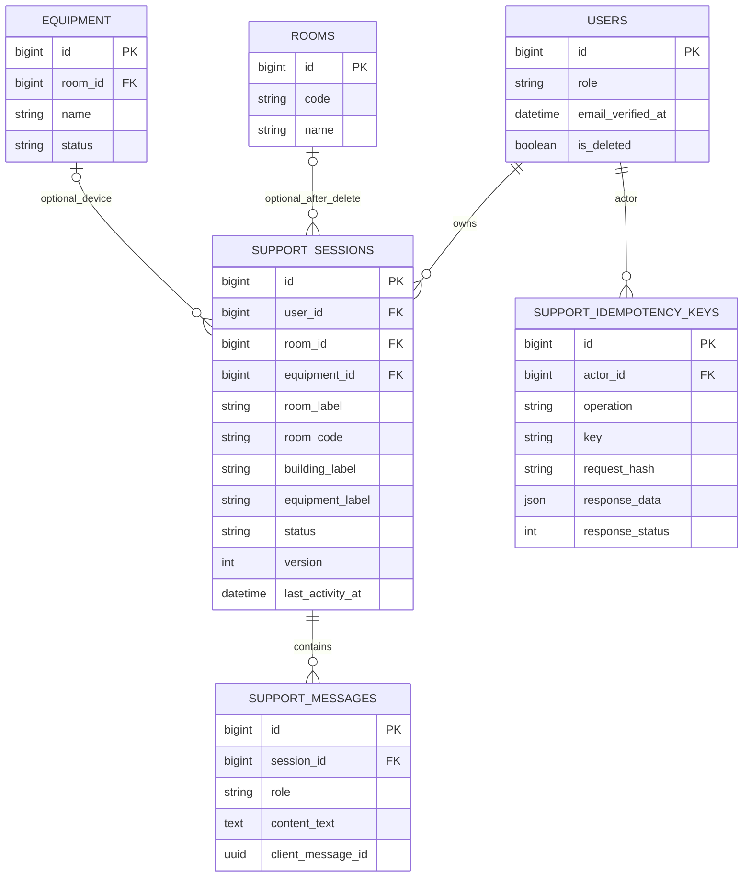
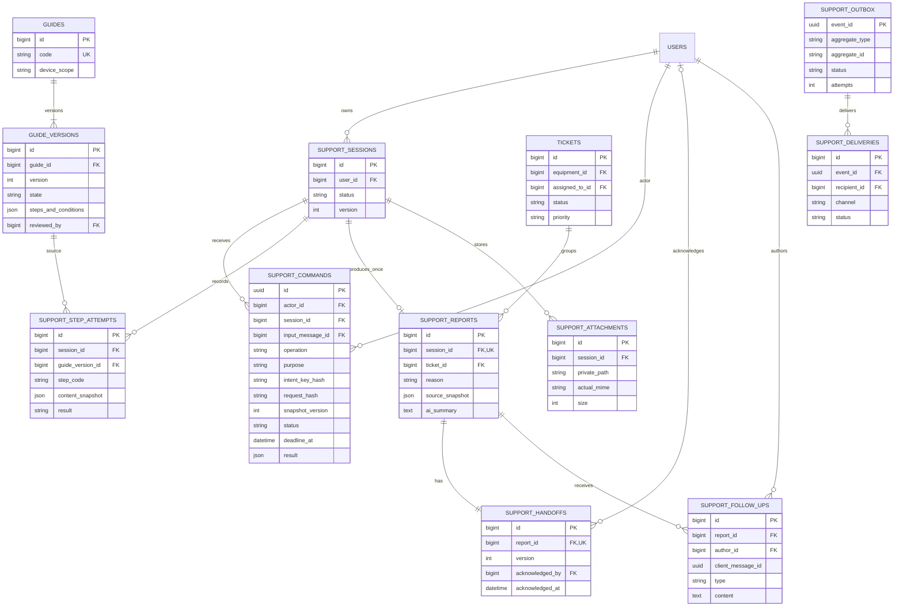

# ERD phần AI

ERD biểu diễn quan hệ dữ liệu, không khẳng định đã có mọi Eloquent relationship. Unique/index/FK và từ điển ở [03](../03_DU_LIEU_VA_API.md), [14](../14_TU_DIEN_DU_LIEU.md).

## DG-ER-01 — CURRENT_CODE M1a

Mỗi phiên mới có ít nhất một message do giao dịch tạo; ký hiệu o{ cho phép trạng thái vật lý tổng quát, bất biến tạo phiên vẫn yêu cầu tin đầu. Idempotency key table không có FK session_id: ID nằm trong response snapshot, không được vẽ một FK giả.

Room/equipment nullable khi xóa, snapshot giữ nguyên. User FK restrict; session deletion cascade messages chỉ qua quy trình retention được phép.

Delta CURRENT_CODE CR-11: support_sessions có deleted_at nullable (migration 2026_11_20_150000). DELETE của chủ phiên là soft delete, không kích hoạt cascade vật lý, không đổi quan hệ report/ticket/messages/command. Phiên chỉ đủ điều kiện khi handed_off và report.ticket.status=closed. Bản SVG baseline 1.1 chưa thể hiện cột này; xem từ điển 14 và evidence CR-11.

## DG-ER-02 — TARGET mở rộng

Tên GUIDES/GUIDE_VERSIONS trong hình rút gọn của troubleshooting_guides/troubleshooting_guide_versions. Outbox dùng aggregate_type/id tổng quát; không vẽ FK đa hình giả vào reports. Những trường khóa ghép như unique actor/operation/intent_key_hash, session/input_message/purpose và event/recipient/channel phải triển khai bằng migration, không chỉ dựa vào ký hiệu UK riêng lẻ trong hình.

Receipt handoff ở SUPPORT_COMMANDS có thể tồn tại trước REPORT; session có report chỉ sau TX-B. input_message_id của handoff nullable. Điều kiện và published của guide version là luật backend, không được bảo đảm chỉ bởi ERD.
