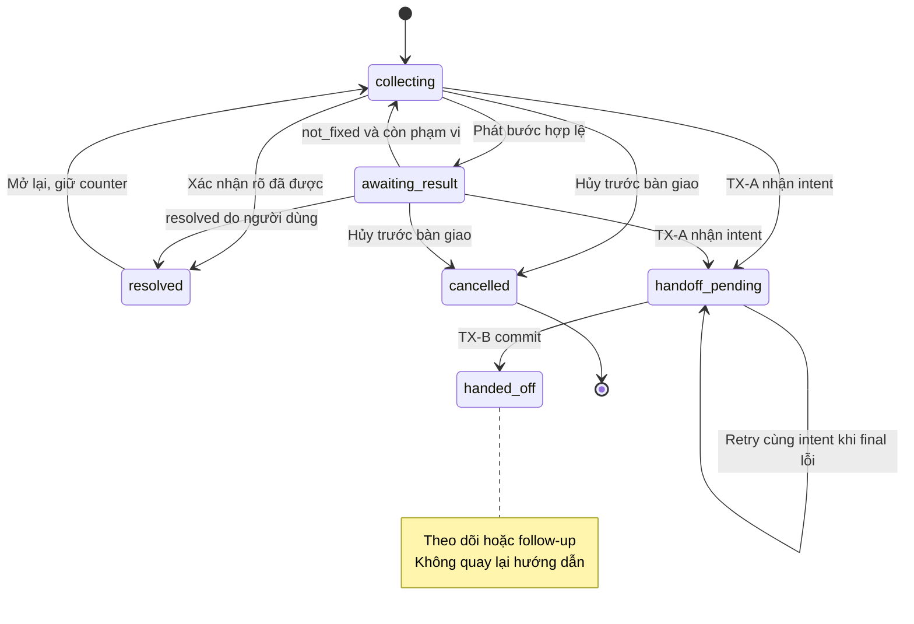
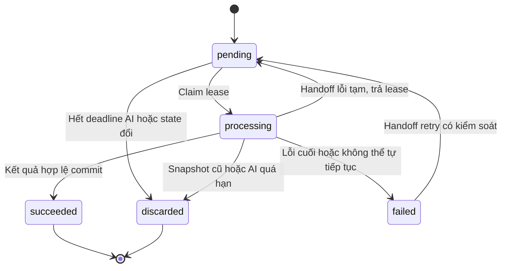
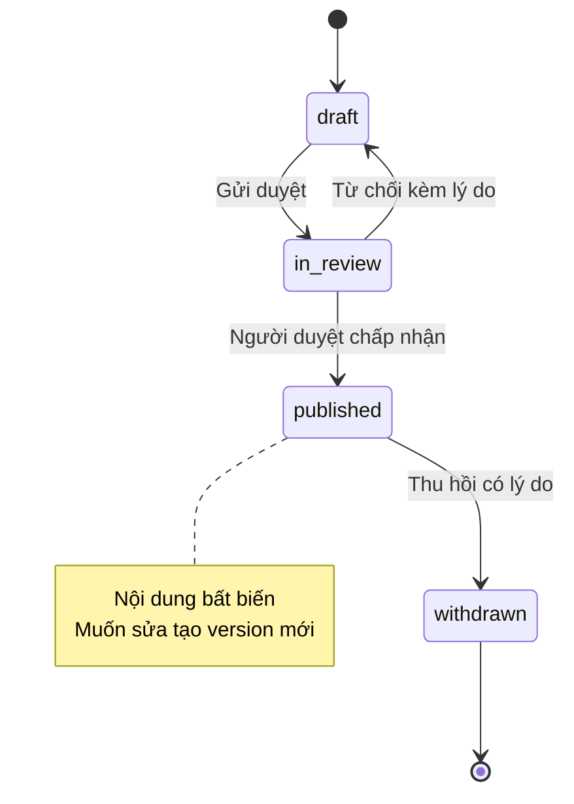
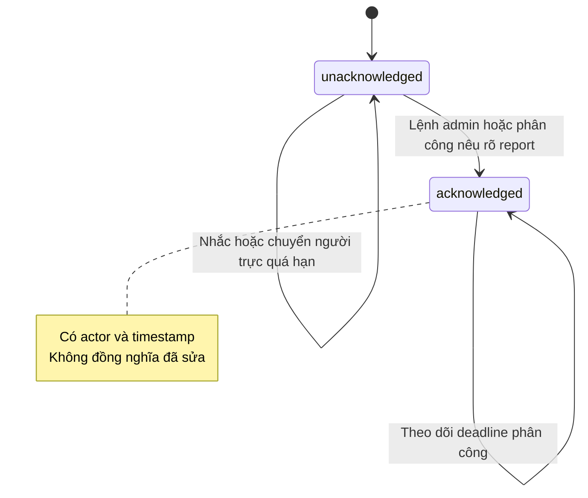
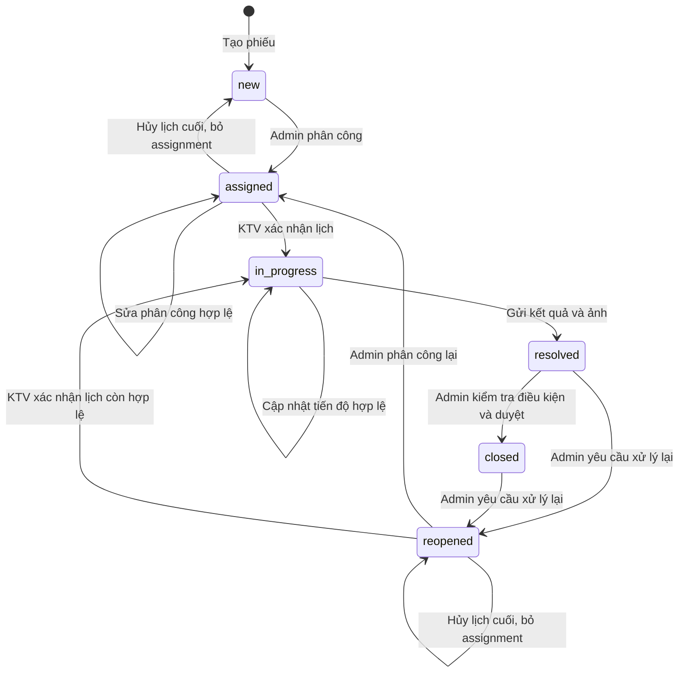

# State machines

File này sở hữu biểu diễn sơ đồ. Luật chuyển trạng thái ở [02](../02_KIEN_TRUC.md), [11](../11_QUY_TAC_NGHIEP_VU.md); không suy thêm chuyển trạng thái từ cách bố trí hình.

## DG-ST-01 — Session TARGET

Delta CURRENT_CODE CR-13: diagnosis.stage là projection quan sát riêng, không thay enum session hoặc đánh dấu resolved. collecting_observations hỏi từng quan sát → ready_for_it khi hết câu hỏi/chưa thể tự xác định; safety_stop ưu tiên dừng. Chỉ yêu cầu report rõ ràng mới đi handoff_pending → handed_off qua giao dịch hiện có. Không đồng nhất ready_for_it với đã gửi phiếu. SVG baseline chưa biểu diễn projection này; contract tại 03 và evidence CR-13.

UC-01–06/09; TC-007/010/011/017/025. Tên enum đã có trong model M1a nhưng phần lớn transition chưa có code.

resolved không đóng ticket. Không có bước AI về collecting từ handed_off/cancelled. Receipt lỗi cuối giữ handoff_pending, không tự resolved.

## DG-ST-02 — Command TARGET

UC-02/04/12; TC-006/021/025/026. Command receipt handoff có từ M2; lượt AI tái sử dụng ở M3.

Hai nhánh về pending chỉ dành cho bàn giao/local recovery theo retry policy; không dùng để hồi sinh lượt AI đã hết deadline hoặc bỏ qua quota. succeeded chỉ replay, không chạy side effect lại. Failed cần lý do, owner và cơ chế xử lý, không tự mở retry vô hạn.

## DG-ST-03 — Guide version TARGET

UC-10; TC-008/009/023.

Không có published→draft cho cùng version. Fixture chưa duyệt không được dùng production.

## DG-ST-04 — Acknowledgement của report TARGET

UC-07/11; TC-015/016. Đây là report acknowledgement, không phải ticket status.

Một report mới liên kết ticket đã assigned vẫn bắt đầu unacknowledged. Không đảo về unacknowledged chỉ vì đọc lại hoặc đổi KTV; audit giữ người đã tiếp nhận.

## DG-ST-05 — Ticket CURRENT_CODE, các chuyển chính đã đối chiếu

Nguồn TicketController::store/assign/acknowledgeSchedule/staffUpdate/close/reopen/cancelSchedule. UC-07/08/09. Đây là phần workflow phiếu liên quan module, không phải migration đổi state.

KTV cập nhật cần lịch đang acknowledged theo code; resolved cần ảnh; close cần các điều kiện hiện có. Reopen hiện xóa ảnh sửa chữa cũ: module AI không gọi thay quyền quản trị. Không thêm trạng thái Open/InProgress hoặc acknowledged vào ticket chỉ vì tên trên sơ đồ khác.
