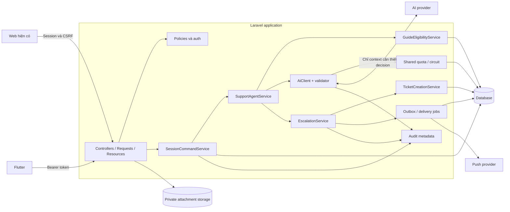

# Component view

DG-CMP-01 — TARGET. View ranh giới/interface, bổ sung sơ đồ tổng thể ở 02. Không yêu cầu microservices, mọi component backend có thể là module trong cùng Laravel.

QUOTA→DB có nghĩa shared atomic store; có thể dùng cache phù hợp môi trường nếu contract/tính nguyên tử được chứng minh. Không dùng memory riêng từng worker.

POLICY phải kiểm tra cả read/write và đường ảnh/command/report, không chỉ controller đầu. Callback/worker vẫn recheck điều kiện trạng thái, không giả client đã kiểm tra thay.

Provider không có đường trực tiếp tới DB, storage hoặc TicketCreationService. Outbox/delivery không tự chẩn đoán. Cấu trúc class cụ thể chỉ tạo theo task có sử dụng, không tạo toàn bộ skeleton trước.
