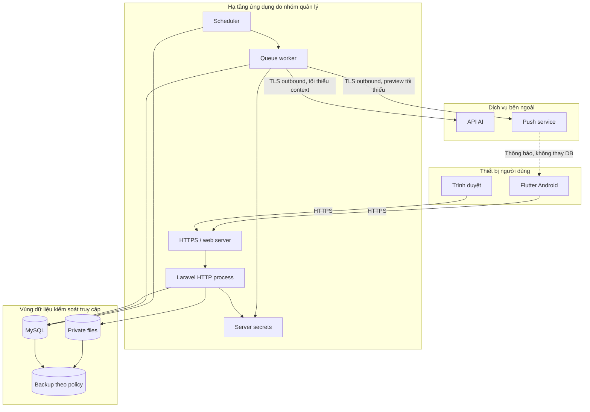

# Deployment và trust boundary

DG-DEP-01 — TARGET pilot, chưa có bằng chứng đã triển khai. Truy vết AI-NFR-004/005/006/009; Q-01/02/04/05/06.

- APPHOST/DATA là vai trò logic, có thể cùng máy pilot; không bắt buộc thuê nhiều server ngay.
- Test/staging/production tách cấu hình, dữ liệu và credential; không dùng test runner vào DB thật.
- Không có GPU/Python inference/Ollama trong đường vận hành đã chốt.
- DB, queue và storage không public trực tiếp cho app; ảnh tải qua endpoint có policy.
- Key chỉ trong secrets server, không nằm trong app bundle/browser/push/backup log.
- Notification DB là lịch sử bền vững; push/WebSocket là kênh bổ sung.
- Worker và scheduler cần cơ chế khởi động lại/giám sát; backup cần restore thực nghiệm.
- Quota/circuit cần shared store; scale thêm worker không được tạo ngân sách riêng ngoài kiểm soát.
- Chưa chọn push provider chính thức tại Q-06; FCM trong sơ đồ là phương án Android dự kiến, không phải cấu hình đã mua/bật.
